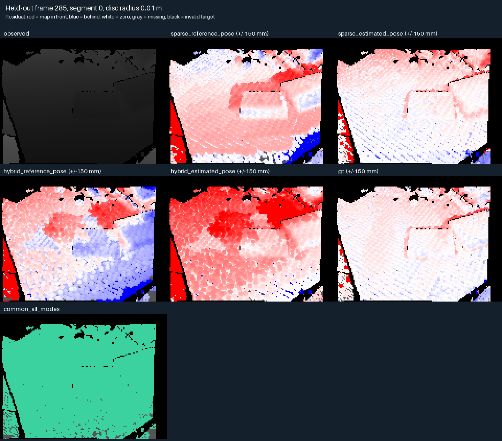

# Held-out RGB-D map validation

Validate a surface-voxel map against RGB-D views excluded from fusion using
`scripts/rgbd_heldout.py`. The runner reuses [mapping](rgbd_mapping.md), strict
odometry loading, canonical input verification and repeat checks. It supports
a single backend with its reference-pose baseline or a matched backend cohort.

## Split, poses and reference policy

Training uses the mapping keyframe schedule: every ten segment-relative frames
plus endpoints by default. Held-out targets use offset five, interleaving them
with training. `--heldout-offset` must lie strictly inside the keyframe stride.
Selection uses frame order independently of geometry, residuals and references.

Each map is bounded and confined to one tracking segment. Held-out targets must
lie strictly between its first and last training frame. Targets between chunks
are excluded. Single-frame chunks have no interior targets. A lost frame begins
an independent segment, and reference poses never join segment origins.

Backend cohorts require identical source selection, calibration, canonical
input fingerprint, provenance, reference arrays, timestamps, segmentation and
training/target indices. Different tracking partitions require separate runs.
All source observations, including unused ones, are read and hashed before
output is published. The reference map uses exactly the same training depth
and filtering, with metric scale fixed and alignment set by the first valid
training reference. It shares sensor/calibration limitations with estimates.

| Mode | Map poses | Target pose | Interpretation |
| --- | --- | --- | --- |
| Reference target | Estimated | Reference through fixed training alignment | Geometry consistency at an externally supplied camera pose |
| Estimated target | Estimated | Same backend's exported estimate | Combined map and localization consistency, including correlated pose errors |
| Reference baseline | Reference | Reference | Sensor, calibration, scene and representation consistency under reference motion |

Missing or nonrigid target references withhold that view. Any missing/nonrigid
training reference withholds the whole chunk's controlled comparison. Estimated
maps still integrate every selected training frame. Reports expose these
exclusions, preserving the intended population rather than fabricating a baseline.

Odometry has already processed held-out observations. These are withheld
**fusion** views among observed viewpoints. Offline maps use past and future
training frames. Scores do not measure unseen tracking, online prediction,
relocalization or generalization to a new scene.

## Rendering and metric populations

Voxel centroids render as camera-facing metric discs at constant camera z.
A nearest-positive-z buffer determines visibility independently of target
measurements. Centers outside the image can contribute through their discs.
Points behind the camera or closer than 5 cm are omitted. There is no observed
residual visibility gate, hole filling, mesh connectivity or residual trimming.

The default radius is 10 mm. Use 15/20 mm radii as footprint sensitivity checks.
Larger discs can increase coverage while bridging holes, smearing silhouettes
or selecting a foreground envelope from inconsistent samples. Smaller discs
can expose background through gaps. Score coverage alongside error.

Evaluation uses native coordinates `[::pixel_stride, ::pixel_stride]`, stride
four by default, preserving the lattice's zero-pixel origin. Target filtering
matches training: defaults are 0.3–4 m depth and conservative 5 cm depth-edge
rejection. Invalid, out-of-range, hole-adjacent and boundary pixels are excluded
once for every prediction. Scores describe this filtered target population.

Reports retain three populations, selected without residual thresholds:

- Own finite predictions on the shared valid-target population.
- Exact common pixels within each target-pose mode, including the reference baseline.
- Exact common pixels across every mode, allowing paired comparisons between modes.

Common masks are coverage-selected subsets and change with radius or split.
Do not compare conditional errors on differing pixel sets as paired measurements.
Each population includes MAE, median, RMSE, p95 and maximum absolute z-depth
error, signed statistics and agreement within 2, 5 and 10 cm.

```text
coverage = predictions / valid target pixels
conditional agreement = predictions within threshold / predictions
explained fraction = predictions within threshold / valid target pixels
```

Missing predictions fail the explained fraction and have no invented depth
error. Negative residuals place geometry in front of measured depth. Positive
residuals place it behind. Both signs remain in scoring because neither proves
occlusion, scene change or pose error. The reference baseline is not an additive
floor to subtract from estimated errors or an independent surface measurement.

Per-view results accompany pooled scores, which weight views by pixel count.
Seeded temporal-block summaries describe dependence sensitivity within a run.
Their intervals do not establish independent trials or cross-scene significance.

## Run and inspect

Create Sparse and Hybrid [odometry runs](odometry.md#running-a-capture) on the
same source and full range, saving them as `outputs/odometry/desk_sparse` and
`outputs/odometry/desk_hybrid`. Then run:

```bash
OPENBLAS_NUM_THREADS=1 OMP_NUM_THREADS=1 uv run --locked python \
  scripts/rgbd_heldout.py \
  --odometry-run outputs/odometry/desk_sparse outputs/odometry/desk_hybrid \
  --render-radii-m 0.01 0.015 0.02 \
  --output-dir outputs/heldout/desk
```

The default held-out submap bound is 64 training frames. Add
`--heldout-offset 3` for another split without changing training. Geometry
options use the same names as `MappingConfig`, available through `--help`.
`--source-path` follows the [mapping relocation policy](rgbd_mapping.md#running-and-inspecting-a-reconstruction).
Use a fresh output directory. Validation failure discards staged artifacts.

Outputs include:

- `report.json` and `summary.csv` with per-view/pooled counts, errors, excluded
  statuses, segment/submap membership, environment and input/code/odometry hashes.
- `inputs.json` with selected frame identity and adapter provenance.
- Estimated/reference maps as NPZ and PLY files.
- Per-chunk/radius view archives containing measured depth, all predictions,
  common masks and candidate/evaluated frame indices.
- First/middle/last target diagnostic PNGs, selected by frame order.

The example below illustrates diagnostic output from a Desk run. Red places map
geometry in front of measured depth, blue behind, gray marks missing predictions,
and black invalid target depth. Green marks common pixels. Display saturation
at 150 mm does not clip the numerical metrics.



Repeat the same command into `outputs/heldout/desk_repeat`, then verify:

```bash
uv run --locked python experiments/verify_mapping_repeats.py \
  outputs/heldout/desk outputs/heldout/desk_repeat
```

The verifier uses NaN-aware exact array equality and compares provenance and
numerical diagnostics while excluding runtime and resource fields. Sampling
retention is bounded by the current chunk and targets. Pooled scoring loads
rendered arrays across the run, so total memory grows with sequence length.
This evaluator targets offline processing.

## Residual diagnosis and limits

`experiments/diagnose_heldout_residuals.py` investigates a saved three-radius
Desk cohort through raw samples, temporal subsets, voxel sizes, footprints,
frame support and a synthetic plane. It requires the original paired
Sparse/Hybrid initial submap with stride four, all saved radii and verified
odometry inputs. Use `--help` for options. `--analyze-only` reuses retained
arrays and verified-input provenance. New rendering requires a fresh directory.
The probe retains substantial arrays and can use substantial temporary memory.

A reference-pose residual combines cross-view depth disagreement, nearest-z
visibility, sampling, calibration, timing and scene change. Finer voxels or
lower depth-objective residual do not guarantee better external geometry.
Interpret reference-target and estimated-target results separately. Independent
scenes, wider temporal gaps and independent surface references are needed to
bound generalization and distinguish physical causes.
