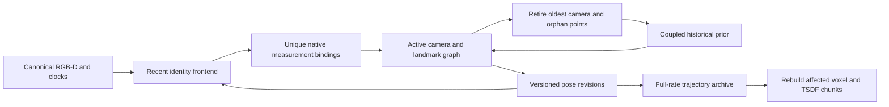

# Experimental incremental SLAM

Historical local outputs were [compacted into evidence archives](output_storage.md).
Restore the required reports and traces before using the saved-run examples below.

Sparse remains the default. `scene_recall.slam` is an opt-in research foundation
for revisable local SLAM. It combines online visual identity tracking, joint
pose/landmark estimation, fixed-lag marginalization and explicit reconstruction
invalidation. It does not yet implement place recognition, loop closure,
inter-segment alignment or global relocalization.

The follow-up [landmark lifecycle investigation](slam_landmark_lifecycle.md)
adds opt-in square-root retirement, coupled point retirement and persistence
selection experiments. Independent capture results remain mixed. Both Sparse
and this document's original experimental defaults are preserved.

The broader [system investigation](slam_system_investigation.md) separates
observability, measurement prediction, finite observation budgets and full-rate
pose output. It adds controlled sensor interventions and offline component and
interpolation experiments while preserving these baselines.

## Architecture and rationale

The earlier frozen-map policies improved some motion measurements while harming
other trajectories and external reconstruction. Full persistent-track batch BA
helped XYZ, but could not observe every Desk/RPY segment. The next experiment
therefore retains shared variables and their cross correlations as the active
window advances. It does not interpret frontend landmarks as exact priors.

The design draws on three established principles. Incremental smoothing can
retain shared historical information efficiently through sparse factorization,
as demonstrated by [iSAM2](https://www.cs.cmu.edu/~kaess/pub/Kaess12ijrr.pdf).
Marginalization fixes historical linearization information, motivating careful
state charts and eventual replay or delayed marginalization, as discussed in
[DM-VIO](https://arxiv.org/abs/2201.04114). Pose revisions require corresponding
surface updates, as demonstrated by
[BundleFusion](https://graphics.stanford.edu/projects/bundlefusion/).
These papers motivate the architecture. This implementation is a bounded dense
reference solver, without their performance or accuracy claims.

[ORB-SLAM3](https://arxiv.org/abs/2007.11898) supplies a complementary direction:
covisible local BA, place recognition and reusable maps. SceneRecall currently
lacks the evidence needed to trust automatic loop factors. A global pose graph
would propagate local association errors as well as valid corrections. The
current milestone establishes a local measurement and revision contract before
adding retrieval, independent loop verification and switchable global factors.



`slam.system.IncrementalSLAM` owns bounded estimator state. A small adapter around
the existing Recent frontend supplies SIFT identities, geometric screening,
map PnP and Sparse fallback. Keyframes enter every five inputs, with eight
retained frontend/graph cameras and at most 128 optimizer landmarks. The frontend
retains its existing 4000-landmark bound. Existing geometric gates stay intact.
New optimizer seeds are selected by image-cell round robin. Existing identities
have priority. This small optimizer budget makes a full coupled prior auditable.

The frontend initializes each incoming pose from images and depth. No saved
trajectory, reference pose or odometry residual enters the objective. Joint
updates feed back into retained frontend cameras, optimized landmarks and the
current pose. Frontend points outside the optimizer follow their latest revised
observer. That approximation is a remaining limitation, rather than an
independent landmark uncertainty estimate.

## Measurement ownership and RGB-D model

Each admitted observation has one `(frame_index, feature_index)` RGB owner and
at most one `(frame_index, native_index)` depth owner. Native indices identify
actual canonical depth-grid samples. For TUM these are supplied registered-depth
pixels, rather than recovered raw IR measurements. Deduplication precedes graph
mutation. Matching
proposals retain the frontend's ambiguity and all-view screening rules.
Optimizer track identities persist across lag boundaries. An orphaned or reset
identity can restart only with new measurements.

`measurements.npz` retains RGB pixels, native points, sample IDs, feature IDs,
frontend and graph identities, frozen exposure transforms, whitening matrices,
initial point seeds and final point estimates. Calibration and original clocks
remain in the version-2 report and per-frame provenance. These artifacts permit
rechecking even marginalized raw factors after final trajectory revisions.

The timed model estimates short exposure motion from the preceding accepted
pose and the provisional current pose, using depth timestamps as pose-proxy
times. It interpolates or extrapolates to the reported RGB/depth clocks, then
binds actual native samples using the existing conservative footprint and edge
checks. Pose at RGB exposure is `T_SD @ inverse(T_RcD)`. Revised depth pose is
`T_SRc @ T_RcD`. Those frozen transforms also govern reconstruction poses.
No reference velocity or future image is used. The experimental timing bridge
reads documented provenance timestamps. A first-class acquisition-time input
contract is still needed for production adapters.

This causal two-pose motion approximation has unknown acquisition latency and
correlated initialization error. A segment's first frame lacks velocity, so the
timed graph waits for admissible native measurements. Unknown clocks disable
native factors and new metric seeds. The explicit `static` ablation assumes
coincident exposures, including on ScanNet. It is not a timing correction.

Both joint models use one-pixel RGB residuals, the existing native depth noise
and motion allowance, separate Cauchy blocks at scale 2.5, and unit weight per
raw observation. `native` uses a whitened three-dimensional native point factor.
`axial` uses only native z and its marginal variance. Axial avoids treating a
nearby native sample's ray as exactly the feature ray, while still assuming it
samples the same surface. Missing depth contributes RGB only for an already
metric track. Neither model estimates shared sensor bias, calibration or clocks.

## Joint optimization and marginalization

`slam.graph` assembles observation-local camera/point blocks and the historical
prior into one dense normal system. It jointly updates all active poses and
points, fixing only the graph's initial camera as its gauge until retirement.
The undamped, diagonally normalized spectrum must pass the `1e8` condition
limit. Damping never supplies missing observability. Each free camera also needs
12 multiview observations and 15% occupied cells on the established 6 by 8 grid.
The reused `BatchConfig` supplies loss and step settings. Its offline
`min_track_views` and `max_cameras` pruning fields are unused here. Incremental
admission uses two-view support and the explicit SLAM window budget.

Up to ten IRLS iterations use bounded line search, with 10 cm camera-center and
point movement and 5 degree rotation limits per update. Failure restores the
complete pre-solve camera and point initialization. Lower cost is a fit
diagnostic, without an external accuracy guarantee.

At the lag boundary, the solver linearizes only factors at the oldest camera
and the previous prior. It eliminates that camera and points without any
remaining raw observation. Shared landmarks remain variable in the new prior,
with every cross term among boundary variables. Eliminating an uncertain old
camera couples the surviving points. Active camera/point cross terms remain in
the joint solve. Every retained raw factor stays outside the prior.
Eigenfactorization builds a square-root factor without
damping, retaining the positive semidefinite range. Historical robust weights
and Jacobians stay frozen. Prior pose charts use translation and Rodrigues
coordinates of `pose @ inverse(origin)`, with differentiated tangent transport.
This is a local Gaussian approximation, without a calibrated posterior or a
full first-estimate-Jacobian consistency claim.

A prototype that eliminated complete tracks to keep camera-only priors failed a
controlled boundary test. When every point persisted, fresh observations became
disconnected from the historical state. The joint prior removes that structural
failure. Dense elimination tests compare full Hessians and gradients across two
boundaries, including orphan points and newly born tracks. A twelve-frame exact
stream preserves 96 shared landmarks over nine retirements.

If marginalization is singular or materially indefinite, the system reports a
`graph_restart` and starts a conditional graph at the incoming keyframe. It
preserves frontend tracking and exposes the lost smoothing history. A graph
with no admitted measurement for `window_size * keyframe_interval`
inputs also expires and restarts conditionally. This prevents a full point
budget from permanently blocking fresh tracks after old identities leave view.
The regression test uses disjoint identities and verifies fresh admission every
lag horizon without inventing a tracking break. A frontend
failure clears both estimator histories and starts an independent trajectory
segment at identity. There is no inferred relationship across that boundary.

## Trajectory revisions and reconstruction

`RevisionArchive` is an output history, separate from bounded estimator state.
Each nonkeyframe retains its rigid transform to its preceding keyframe.
Revisions update that keyframe and all attached frames. Segment boundaries stop
attachments. This avoids interpolation using future poses, but creates a
piecewise correction field. It cannot refine nonkeyframe relative motion.

The experiment exports both originally emitted poses and the final revised
trajectory. Final relative transforms are recomputed from final adjacent poses,
so version-2 archives remain compatible with mapping. `revisions.json` records
revision times, versions, keyframes and dirty frame IDs. A reconstruction must be
associated with a trajectory version. The reference workflow rebuilds surface
and TSDF maps from original depth and the final revised poses. It never fuses
optimized sparse landmarks as dense surface measurements.

This milestone does not maintain a live GPU volume or implement reversible
weighted TSDF updates. Rebuilding affected bounded chunks is the correctness
path. Incremental background rebuilding, atomic map-version publication,
checkpoint/resume and global submap deformation remain future work.

## Reproduction

Create or reuse a same-range 1500-feature Sparse baseline. It supplies canonical
input verification and evaluation references, without initializing SLAM poses:

```bash
OPENBLAS_NUM_THREADS=1 OMP_NUM_THREADS=1 uv run --locked python \
  scripts/rgbd_odometry.py --tum-path data/tum/sequence \
  --backend sparse --max-features 1500 --output-dir outputs/slam_baseline

OPENBLAS_NUM_THREADS=1 OMP_NUM_THREADS=1 uv run --locked python \
  experiments/incremental_slam.py --baseline-run outputs/slam_baseline \
  --output-dir outputs/slam_case --evaluate-maps
```

The experiment requires a fresh output directory and verifies the full source,
provenance, calibration, references and canonical input digest. Reference poses
are stripped before estimator access. It records configurations, source and
implementation hashes before evaluation. Raw feature extraction is the default.
Optional `--features FEATURES.npz` replays immutable prior feature arrays and
records their hash. Cached timings exclude extraction and cannot establish
end-to-end throughput. Policies have independent online histories.

`--variants control native axial static` selects the primary comparison.
`control` disables joint optimization under the same frontend budget/cadence.
`wide` retains sixteen cameras with the same point budget as a horizon diagnostic.
The separate historical Recent policy differs in cadence, camera budget and
optimizer point population, so it is an additional comparator.

A portable matrix launcher accepts repeated `--case NAME BASELINE FEATURES`,
where `raw` selects fresh features, or `--baseline-root` for the eight retained
reliability windows. `--workers` controls subprocess concurrency. Parallel and
interleaved-policy timings are not a latency ranking. Maps can be generated
later using `--maps-only` with the same baseline and variants.

Reconstruction preserves the established 2 cm voxels, stride-eight depth,
every-tenth training frame, offset-five target frame, 24 training views per
chunk and 1 cm render discs. The predetermined first chunk supplies TSDF.
Missing references withhold whole chunks. Differing segment boundaries withhold
the controlled comparison. Report coverage, explained fraction and a 20 cm
capped error charging missing predictions, alongside exact common-pixel error.
Target RGB and depth can enter both the online frontend and the joint graph.
The holdout concerns fusion and evaluates reconstruction after tracking. It does
not supply independent bundle-adjustment measurements or novel-view tracking
validation. Reference-pose fusion is a control, without independent surface truth.

## Evaluation

Evaluated on Ubuntu on 2026-10-21, with one OpenCV/OpenBLAS/OMP thread and no
new dependency. Sparse remains the default. The shared graph and revision
contracts are useful foundations. The results do not support promoting any new
tracking policy.

The original fixed matrix covers 2,000 observations in six TUM windows from two
captures and two windows from one ScanNet capture. Those windows were already
studied in earlier investigations. They are regression evidence. Frame and
window counts are not independent scene replicates.

The table reports aligned fixed-scale position ATE RMSE in millimeters. All
variants use the same reference population and remain continuous. The control
uses the same frontend cadence, camera budget and measurement maintenance, with
joint optimization disabled. It differs from the historical Recent frontend.
The experiment changes measurement usage, joint revision and subsequent
association feedback together, so improvements have no single-component causal
attribution.

| Window | Budget Sparse | Control | Timed native | Timed axial | Static native |
| --- | ---: | ---: | ---: | ---: | ---: |
| Freiburg 2 Desk, 0:300 | 17.35 | 31.84 | 20.56 | 20.95 | 26.99 |
| Freiburg 2 Desk, 1200:1500 | 13.05 | 7.00 | 15.65 | 15.10 | 19.13 |
| Freiburg 2 Desk, 600:800 | 4.78 | 10.69 | 14.39 | 14.18 | 11.79 |
| Freiburg 3 Office, 0:300 | 37.31 | 12.10 | 15.48 | 17.07 | 11.78 |
| Freiburg 3 Office, 1200:1500 | 21.50 | 8.84 | 10.04 | 9.10 | 20.68 |
| Freiburg 3 Office, 600:800 | 16.30 | 16.81 | 7.72 | 8.18 | 6.55 |
| ScanNet, 1000:1200 | 38.39 | 53.08 | 53.08 | 53.08 | 59.95 |
| ScanNet, 3500:3700 | 49.80 | 56.51 | 56.51 | 56.51 | 55.87 |

Timed native improves ATE over the matched control in two of six TUM windows
and worsens four. Native and axial exactly equal the control on both ScanNet
clips because unknown clocks prevent metric graph admission. Those rows provide
an abstention control. They are not optimization gains. Explicit static exposure
remains a sensor-model assumption.

### New scene validation

An additional [official TUM sequence](https://cvg.cit.tum.de/data/datasets/rgbd-dataset/download),
Freiburg 3 Structure Texture Far, supplies a new textured wooden-panel scene.
The source description and fixed ranges 0:300 and 400:700 were selected before
source extraction or score inspection. The download archive and tables have
SHA256 manifests. Its 907 canonical pairs require no reference-table repair.
The tested windows contain 297 and 300 valid references. All settings remain
unchanged. Two windows from this single capture are one new-scene replication.

| New window | Budget Sparse | Control | Timed native | Timed axial | Static native |
| --- | ---: | ---: | ---: | ---: | ---: |
| Structure, 0:300 | 11.86 | 8.85 | 9.41 | 8.83 | 10.79 |
| Structure, 400:700 | 17.01 | 13.46 | 15.90 | 15.58 | 15.30 |

Both native trajectories improve over Sparse and worsen against the matched
control. Early-window capped surface error improves from 64.33 to 61.48 mm
against that control, while late-window surface error worsens from 36.90 to
38.33 mm. Late-window TSDF changes from 16.00 to 16.16 mm. Early-window TSDF is
withheld for missing training references. There is no consistent independent
scene gain attributable to joint smoothing.

### Full-sequence trajectory and horizon controls

These Freiburg 1 sequences are development captures related to prior work.
XYZ has 792 inputs, Desk 573 and RPY 694. ATE below uses all 789 available XYZ
references, all 573 Desk references, and the largest 579-frame RPY segment.
RPY retains its original loss at frame 115 in every method. No method supplies
one trajectory or a reference-based transform across that break.

| Full sequence | Budget Sparse | Control | Native 8 | Axial 8 | Static 8 | Native 16 |
| --- | ---: | ---: | ---: | ---: | ---: | ---: |
| XYZ | 55.11 | 41.80 | 31.92 | 29.41 | 39.97 | 17.85 |
| Desk | 75.84 | 54.10 | 59.47 | 49.21 | 51.31 | 59.21 |
| RPY, largest segment | 50.64 | 39.29 | 46.09 | 54.69 | 44.76 | 30.03 |

XYZ root-anchored orientation RMSE is 1.46 degrees for the control, 1.33 for
native eight and 0.96 for native sixteen. RPY changes from 10.15 to 11.50 and
8.03 degrees respectively. Desk orientation improves from 5.65 to 5.35 and
4.15 degrees while its position ATE worsens against the control. Horizon,
position and orientation improvements do not transfer uniformly.

The corrected native eight graph refines 69 XYZ, 13 Desk and 10 RPY updates.
It rejects 85, 66 and 84 attempted updates respectively, with 3, 6 and 8 graph
restarts. Sixteen-camera XYZ refines 28 and rejects 119 updates, with two
restarts. These are conditional update counts, rather than full-rate tracking
confidence. Most poses still depend on frontend initialization and keyframe
attachments.

The long Desk prototype exposed point-budget starvation: after tracks left
view, cameras stopped entering the graph and camera-count eviction could not
advance. The final lifecycle rule expires an inactive graph at its configured
horizon. Full Desk/RPY were rerun with that correction. An AST comparison proves
that the estimator change is limited to this guard, and a trace audit shows it
would not fire in the original eight windows, either new-scene window or full
XYZ. Their retained trajectories remain applicable. Prototype full Desk/RPY
results are superseded by `lifecycle_verified/`.

### Reconstruction

Primary capped depth errors in millimeters charge missing predictions 200 mm.
Voxel fusion uses all eligible chunks. TSDF uses only the predetermined first
chunk, with exact shared target populations across policies.

| Regression population | Representation | Budget Sparse | Control | Timed native |
| --- | --- | ---: | ---: | ---: |
| Early Desk, 23 views | Voxel | 52.83 | 52.57 | 43.51 |
| Early Desk, 23 views | TSDF | 36.31 | 34.41 | 30.38 |
| Late Desk, 6 views | Voxel | 68.11 | 67.08 | 68.26 |
| Early Office, 6 views | Voxel | 37.66 | 36.89 | 37.33 |
| Late Office, 29 views | Voxel | 59.59 | 42.88 | 45.43 |
| Late Office, 23 views | TSDF | 41.23 | 25.46 | 27.42 |
| Middle Office, 20 views | Voxel | 63.11 | 63.80 | 37.51 |
| Middle Office, 20 views | TSDF | 54.09 | 54.39 | 29.27 |
| ScanNet 1000, 20 views | Voxel | 65.13 | 67.39 | 67.39 |
| ScanNet 1000, 20 views | TSDF | 36.04 | 33.63 | 33.63 |
| ScanNet 3500, 20 views | Voxel | 83.21 | 79.31 | 79.31 |
| ScanNet 3500, 20 views | TSDF | 75.03 | 67.41 | 67.41 |

Middle Desk has no matched reconstruction chunk. The missing-reference first
chunks of late Desk and early Office withhold TSDF. No replacement chunk is
chosen. Native improves over the matched control on two of seven surface
populations and two of five TSDF populations. Both ScanNet equalities reflect
the unoptimized control, so their gains against Sparse cannot be credited to BA.

The full development trajectories give another representation trade-off:

| Full population | Representation and views | Budget Sparse | Control | Native 8 | Axial 8 | Native 16 |
| --- | --- | ---: | ---: | ---: | ---: | ---: |
| XYZ | Voxel, 75 | 36.00 | 35.21 | 33.60 | 33.69 | 33.56 |
| XYZ | TSDF, 22 | 33.03 | 32.22 | 25.98 | 27.15 | 27.99 |
| Desk | Voxel, 55 | 56.47 | 61.06 | 59.33 | 58.05 | 59.58 |
| Desk | TSDF, 23 | 56.42 | 53.08 | 51.64 | 50.49 | 49.30 |
| RPY | Voxel, 44 | 86.24 | 81.12 | 78.75 | 79.67 | 79.66 |
| RPY | TSDF, 11 | 81.38 | 94.00 | 93.96 | 85.19 | 65.27 |

RPY's largest-segment ATE and first-segment TSDF use different temporal
populations. The first-chunk score does not measure the improved largest
segment. Missing training reference 445 withholds a later controlled submap.
All summaries retain coverage, explained fraction, exact common-pixel MAE and
valid target counts alongside these capped scores.

A separate post hoc XYZ extent diagnostic increases only the submap budget to
128, fusing all 81 selected training views. It evaluates 78 of 79 target
candidates, excluding missing reference 195. TSDF capped error is 90.78 mm for
Sparse, 72.75 for the control, 46.07 for native eight and 29.64 for native
sixteen. Reference-pose fusion gives 19.32 mm as a control. This demonstrates a
large long-map improvement on XYZ. It is kept separate from the primary short
submap ranking, where native eight beats native sixteen on TSDF.

### Interpretation controls

The ideal linearized shared-point control gives marginal camera translation
variance traces about 2.02 times the conditional fixed-landmark traces. This
quantifies missing uncertainty under that synthetic independent-noise model,
without calibrating real sensor error. A second control scales every native
sample, landmark and camera translation by 1.05. It retains a numerical zero
RGB-D residual and an observable conditional system, yet has 4.23 mm endpoint
error and approximately 149 mm mean landmark error. Shared uncertainty and
small residuals cannot identify a coherent metric depth-scale error.

On late Freiburg 2 Desk, complete batch relinearization of exactly the saved
native factors reduces cost from 1206.37 to 1187.38, but ATE only changes from
15.65 to 14.94 mm, versus 7.00 mm for the matched frontend control. On early
Desk, cost falls from 911.59 to 883.24 while ATE changes from 20.56 to 20.62 mm.
Marginalization approximation cannot alone explain those rankings. These are
post hoc fixed-association diagnostics, without an identified physical cause.

Controlled sixty-frame XYZ inputs preserve tracking through ten missing-depth
inputs for both the matched frontend and joint smoother. Sparse loses ten
transitions. All policies lose eleven transitions with black RGB. A 50% depth
scale intervention preserves continuity but raises native ATE from 7.68 to
12.16 mm. The tracker is not a sensor-fault detector. Fragmented black-RGB ATE
covers its largest segment and must not be compared with clean full-run ATE.

Commands for these mechanism checks are:

```bash
uv run --locked python experiments/diagnose_slam_prior.py \
  --output outputs/slam_prior_controls.json
uv run --locked python experiments/slam_outages.py \
  --tum-path data/tum/rgbd_dataset_freiburg1_xyz \
  --output-dir outputs/slam_outages
uv run --locked python experiments/replay_incremental_slam.py \
  --run outputs/slam_case/native --output-dir outputs/slam_relinearized
```

### Consistency, association and computation

Every retained measurement archive has unique RGB and canonical depth-sample
ownership. Historical raw-factor rechecks include marginalized observations and
final point estimates. For example, early Desk native has 2,356 RGB observations,
0.71 px final RGB RMSE, 99.58% within 3 px and no cheirality failures, despite
worse ATE than Sparse. Selected residuals cannot establish external consistency.

Direct descriptor checks at one, two and four admitted-keyframe offsets find
identity disagreements among selected endpoints. Early Desk has 17/1,219 at
one offset and 22/700 at four. Late Desk has 11/1,717 and 7/1,150. These
conditional disagreements indicate residual identity ambiguity. They do not
supply true correspondence labels or false-match probabilities. Association
reliability remains unresolved even when all-view geometry and robust costs pass.

Serial raw-input 80-frame XYZ runs in opposite orders measured 4.52–4.58 frames/s
for budget Sparse, 3.59–3.69 for the matched no-BA control and 3.49–3.54 for native
eight. Native's final-forty-frame median estimator call is approximately 204 ms,
its keyframe p95 is 699–730 ms, and median joint solve time is 80–84 ms.
The control also constructs measurements and marginal priors. Results include
warm input decoding and verification in throughput, with fresh feature
extraction. They are short single-machine measurements without real-time or
machine-isolation guarantees. Concurrent matrix timings are excluded.

The optimizer holds at most 128 points and eight or sixteen cameras, for dense
state dimensions at most 432 or 480. Observation storage is bounded by the
window. The output archive grows with recording length. A sparse square-root
factorization is the next performance direction, with these dense systems as
reference algebra. Larger windows have not been validated on the new scene.

### Reproducibility and retained evidence

`evidence_manifest.json` hashes the curated scientific artifacts and records
final case selection and verification scope. Historical `outputs/incremental_slam/`
contained fixed protocols, a downloaded-source manifest, raw measurement archives,
emitted and final poses, revisions, map predictions and paired summaries.
The [storage capsule](output_storage.md) retains the compact evidence, while map
predictions, feature caches and dataset images require regeneration. `matrix/`
and `independent/` are authoritative short-window runs. `full_sequences/xyz/` remains the full XYZ result.
`lifecycle_verified/{desk,rpy}/` replaces the full Desk/RPY prototypes.
The full-sequence summary uses those replacements explicitly.
`outages_release/` contains the final-code intervention replay.
`serial_timing/` contains the serial raw-input timing matrix.
`xyz_extent/` is the separate extent diagnostic. Prototype pilots, the
camera-only solver and the uncorrected full Desk/RPY runs are excluded from
promotion evidence.

Before output compaction, all 1,927 protected older scientific files were
unchanged. Fresh budget-Sparse runs reproduce every archive array on full Desk, full RPY and an 80-frame XYZ
prefix. All four policy raw/cached repeats match final and emitted poses,
measurement arrays, evaluations and non-timing diagnostics exactly. Their
80 emitted poses equal the full XYZ prefix, and the first 40 sealed final poses
also match. Later observations may revise the active suffix, so final suffix
prefix equality is not expected.

The summary recomputes emitted pair diagnostics from `emitted_trajectory.npz`.
Older raw reports inherited final pair diagnostics in that field. Their emitted
ATE and RPE already use emitted poses and are unchanged. Current exports keep
both pose populations internally consistent. TSDF summaries distinguish target
candidates from actually evaluated reference-valid targets.

Frozen benchmark reports retain their original implementation fingerprints.
`verification_final.json` records exact repetitions, the unchanged joint solver,
the lifecycle-only source change and its inactive branch on unaffected runs.
The full Linux suite passes 872 tests, including geometry, marginalization,
turnover, outage, export, target-population and mapping compatibility contracts.
Ruff and whitespace checks pass. No dependency, lockfile, existing backend
default or dataset reader changed.
Native Windows, hosted CI, a second ScanNet capture, wider input cadence and
long-duration live mapping remain untested.

To reproduce the retained summary selection and repeat checks:

```bash
uv run --locked python experiments/summarize_incremental_slam.py \
  outputs/incremental_slam/matrix
uv run --locked python experiments/summarize_incremental_slam.py \
  outputs/incremental_slam/full_sequences \
  --replacements-root outputs/incremental_slam/lifecycle_verified
uv run --locked python experiments/verify_incremental_slam.py \
  outputs/incremental_slam --output outputs/slam_verification_repeat.json
```

### Next architectural decision

Retain native measurement ownership, persistent shared state, coupled priors
and explicit reconstruction revisions. Continue using Sparse for default runs.
The current evidence supports revisable local SLAM as infrastructure and does
not identify a universally better estimator.

Before global loop closure, prioritize independently validated camera/depth
geometry and acquisition timing, better identity verification, and landmark
scheduling that can release stale support without discarding an entire graph.
A sparse factorization and replayable or delayed marginalization can then improve
cost and historical linearization. Scale or clock nuisance variables need
independent evidence and observability analysis, since fitting them alone cannot
remove the demonstrated metric ambiguity. Loop candidates will need independent
verification before they can revise submaps and trigger reconstruction updates.
