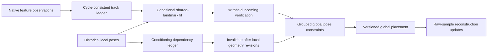

# Conditional multiview registration and revision dependencies

This investigation follows the [metric-estimation study](online_metric_estimation.md).
It adds an optional observation-level shared-landmark fit to historical registration
and recovery, and makes the resulting loop constraints depend explicitly on the
historical geometry used to estimate them. Existing defaults remain unchanged.
The complete-pipeline evidence is mixed and does not support promotion.

## Architecture diagnosis

The online system contains several different estimation models:

- Local tracking fits fixed recent landmarks and can fall back to consecutive
  native-depth PnP or recent-anchor recovery.
- The optional local smoother maintains raw RGB-D factors, revisable landmarks,
  camera states and a marginal prior over its active window.
- Historical registration fits two-view transforms from retained feature arrays.
  Previous metric refinement changes these poses without changing the local
  estimator or giving the global graph a shared observation model.
- The global graph combines local pose summaries and verified camera transforms
  under engineering weights and temporal correlation groups.
- Reconstruction integrates original camera-local surface samples after global
  placement and rebuilds affected chunks after revisions.

More correspondences, lower residuals and more accepted pose factors do not align
these models automatically. Shared native depth, fixed historical pose error,
source calibration, repeated observations and selection effects can propagate
through their interfaces. The new experiment tests one controlled bridge:
shared landmark variables in conditional three-view registration.

[ORB-SLAM3](https://doi.org/10.1109/TRO.2021.3075644) uses covisible geometry for
place verification and a joint welding adjustment during map merging. That
motivates using historical observations rather than comparing only independently
estimated pair transforms. [Bundle Adjustment: A Modern Synthesis](https://thoth.inrialpes.fr/people/triggs/pubs/Triggs-hdr-papers.pdf)
provides the shared structure/camera formulation and sparse elimination principle.
[Square Root Marginalization](https://arxiv.org/abs/2109.02182) explains why retained
priors and their linearization points matter when joining local and global state.
The current experiment adds no new marginalization prior.

[DROID-SLAM](https://arxiv.org/abs/2108.10869) and
[MASt3R-SLAM](https://openaccess.thecvf.com/content/CVPR2025/html/Murai_MASt3R-SLAM_Real-Time_Dense_SLAM_with_3D_Reconstruction_Priors_CVPR_2025_paper.html)
show integrated correspondence, geometry and global estimation designs. Their
reported results are not performance evidence for SceneRecall. No learned
pointmap, GPU model or new feature family is evaluated here. The intervention
keeps the preceding SIFT frontend, match thresholds and raw sensor evidence fixed.

## Shared conditional model

`--multiview-registration` uses one source view, one historical context and the
incoming view. Source and context must belong to the same local tracking segment.
Only already received observations are eligible. The coordinator examines at most
three retained context views with a local translation baseline of at least 2 cm.
Each candidate requires mutual descriptor matches on all three view pairs with
consistent row identities around the cycle. The context with the most supported
tracks is selected deterministically.

There are at most 128 tracks, with at most 64 in each original fitting/verification
population. Subsampling preserves the original pair registration split, including
when contextual association removes an odd number of tracks. No verification
track can enter the initializer through a relabeled split.

Each latent source-frame landmark has:

- One source RGB-D prior, propagated from its native measured pixel and depth.
- One RGB observation in the historical context, whose local pose stays fixed.
- One incoming RGB observation, for fitting tracks only.

The point prior uses the preceding 1 px lateral and `0.005 + 0.01 z` meter axial
noise proxy. It is a conditional engineering model. Context depth and incoming
depth add no fitting factors. They are not replicated as extra independent metric
observations. A three-dimensional source prior incorporates the source pixel and
depth together, without a second source reprojection term.

The joint fit optimizes one incoming six-dimensional pose and shared landmark
coordinates. Analytic Jacobians, block Huber weights and Schur elimination reduce
each iteration to a six-dimensional camera solve and independent landmark back
substitution. There are six iterations, four line-search fractions, bounded
translation/rotation/point steps and a depth-normalized rank check. The reduced
matrix checks conditioning and is never exported as calibrated graph confidence.

Separate historical-only landmark fits predict the withheld incoming observations.
The final result must pass withheld image, native-depth, coverage and geometry
checks. Original source samples are checked as well as historical model points.
Historical fits and checks do not create independent measurements. Without a
usable context, the existing two-view result is retained with an explicit fallback
status. If a conditional fit starts and fails verification, it abstains.

Raw feature arrays remain immutable. Diagnostics retain context frame ID, exact
source/context/target feature-row triples, fitting and verification row indices,
source/context/incoming depth-factor counts, the conditioned transform and solver
statistics. Model landmark estimates do not become native depth or reconstructed
surface measurements.



## Revision-aware derived constraints

A native two-view transform is measured in camera coordinates and can stay
immutable when local poses change. A conditional transform also depends on the
source-to-context local pose used during fitting. Treating both kinds as immutable
raw constraints would retain stale geometry after local optimization.

The coordinator now records that dependency for conditional loop proposals and
accepted edges. Before publication it compares the current source/context
relative pose to the stored transform. A changed relative pose invalidates the
proposal or revokes the derived loop and clears stale confirmation state. A
revoked bridge forces a global solve before publication, even outside the normal
solve interval. Reconstruction then receives the resulting version and dirty
frames through the existing interface. A common rigid local gauge change leaves
the dependency unchanged and does not revoke the loop.

Only dependencies belonging to retained confirmation state or graph constraints
survive place-bank pruning. The registry contains IDs and a transform, without
retaining another history of feature arrays. Native pair constraints retain their
existing lifecycle. Re-verification after invalidation uses future raw queries,
rather than fabricating unavailable past evidence.

This safeguard covers local revisions. Global placement does not feed back as an
independent local measurement, and the conditional registration remains a fixed
pose summary in the global graph. It is not a joint three-camera global factor.
Global deformation, shared historical pose error and cross-query correlations
remain approximation limits of this hierarchy.

## Controlled geometric evidence

Thirty seeded controls per condition compare the same noisy image measurements
and source depths. These are synthetic model checks, not independent recordings.
Each camera pose is evaluated against its known generating transform and each
landmark against its generating point, independently of fitting cost.

| Condition | PnP median translation, mm | Bundle median translation, mm | PnP / bundle median rotation, degrees | Source / fitted point RMSE median, mm |
| --- | ---: | ---: | ---: | ---: |
| Independent noise | 6.50 | 5.11 | 0.161 / 0.117 | 34.95 / 31.15 |
| Source depth scaled by 1.03 | 6.25 | 5.33 | 0.161 / 0.117 | 95.72 / 84.33 |
| Context pose translated incorrectly by 2 cm | 6.50 | 5.32 | 0.161 / 0.156 | 34.95 / 46.91 |
| Source depth and context translation both scaled by 1.03 | 6.25 | 5.18 | 0.161 / 0.117 | 95.72 / 93.27 |

The inaccurate-context control improves pose statistics while worsening landmark
geometry, despite lower objective cost. The shared-scale case barely repairs the
metric point bias. More views do not remove errors in the state on which those
views are conditioned. These controls do not prove the presence of a particular
calibration or scale error in a real recording.

## Full causal pipeline evidence

The main comparison uses CLAHE, half-resolution SIFT, optical-flow recovery and
scheduled global solves, with raw revision-aware mapping. The alternative enables
conditional registration for recovery and loops. Parameters were fixed before
these runs. There is no terminal retrospective solve.

Eight independent recordings supply 4,504 distinct natural inputs. Seven were
used in the preceding metric study, totaling 4,104 inputs. An additional 400-input
TUM Desk window extends the current evaluation to another recording, although
that dataset appeared in older project studies. This does not establish unseen
scene generalization. Outages, ablations and repeated prefixes are not extra
independent data.

Translation RMSE below uses the common causal root-connected population. Missing
references can reduce the scored subset. No independent map gauges are silently
joined for evaluation.

| Recording | Inputs | Common root inputs | Failed transitions, both | Causal translation RMSE, mm, control / multiview |
| --- | ---: | ---: | ---: | ---: |
| TUM XYZ | 792 | 792 | 0 | 20.90 / 20.82 |
| TUM RPY | 694 | 694 | 0 | 117.82 / 121.72 |
| TUM Pioneer | 600 | 75 | 23 | 30.23 / 30.67 |
| ScanNet | 200 | 200 | 0 | 103.44 / 103.00 |
| ETH3D Sofa | 533 | 190 | 26 | 33.40 / 33.88 |
| ETH3D Shake | 285 | 7 | 135 | 15.72 / 15.72 |
| ETH3D Desk | 1,000 | 774 | 2 | 50.67 / 55.02 |
| Additional TUM Desk | 400 | 400 | 0 | 49.17 / 48.42 |

The local trajectory arrays and transition failures match exactly across all nine
main cases, including the two controlled XYZ outages. The additional TUM Desk
comparison improves translation slightly but worsens rotation RMSE from 3.098 to
3.358 degrees. That is mixed accuracy, without an availability improvement.

Sofa's whole emitted root loses connectivity, from 262 to 190 inputs. Its whole
root RMSE changes from 44.27 to 33.88 mm, but that apparent gain changes the
population. The common-population comparison slightly worsens. Shake's seven
common root inputs cannot summarize accuracy over its fragmented recording.

RPY active loops fall from 103 to 96, with reference-scored 10 cm / 5 degree
violations falling from four to one. Trajectory accuracy nevertheless worsens.
Other active loop counts also decline: XYZ 373 to 351, Sofa 55 to 28, Pioneer
30 to 15 and ETH3D Desk 47 to 30. Strict multiview filtering can remove useful
relationships along with inaccurate ones. Threshold counts do not measure the
value or covariance of the remaining constraints.

Three complete loops-only scope ablations on RPY, Sofa and ETH3D Desk reproduce
the corresponding full multiview trajectory, atlas, constraint and reconstruction
arrays exactly. The measured changes on these recordings come from historical
registration/global placement, rather than altered local recovery. A synthetic
recovery test with nonidentity sensor extrinsics verifies that the shared model
can be used by that interface when suitable context exists.

## Interaction with local revisions

Four raw 120-input runs enable the existing joint local smoother on XYZ and RPY,
with and without conditional registration. XYZ has 16 updates revising historical
frames and RPY has six. The multiview XYZ run invalidates two historical
conditioning dependencies. The integration test additionally verifies that
revoking a stale conditional bridge disconnects its map before publication, even
when the normal solve interval has not elapsed.

XYZ causal root RMSE is 13.88 versus 13.94 mm. RPY is 84.54 versus 84.91 mm. These
short windows do not demonstrate a joint-state accuracy gain or a solution to
long-horizon marginalization and loop consistency. They exercise real raw-stream
local revisions and conditional constraint lifecycle interactions.

## Reconstruction evidence

The fixed-reference target and native depth protocol assesses held-out geometry.
It is not independent physical surface truth. Lower capped error is better.

| Recording | Capped surface error, mm, control / multiview |
| --- | ---: |
| XYZ | 47.64 / 47.97 |
| RPY | 88.68 / 87.90 |
| Pioneer | 150.82 / 150.97 |
| ScanNet | 92.27 / 91.86 |
| Sofa, each admitted cohort | 46.92 / 47.14 |
| Sofa, common training cameras | 47.28 / 47.14 |
| Shake | 151.12 / 151.12 |
| ETH3D Desk, available-reference cohort | 41.73 / 43.79 |
| Additional TUM Desk | 57.31 / 57.03 |

ETH3D Desk omits fixed training indices 170 and 190 through the explicit
available-reference protocol and retains 22 common training cameras. The strict
protocol would withhold that comparison. No missing reference is replaced by an
estimated camera. Map quality, trajectory translation, rotation and connected
coverage remain separate outcomes.

## Reproduction

Use fresh output directories. These options preserve the preceding defaults:

```bash
uv run python -m scene_recall.slam.cli \
  --tum-path local_inputs/recording --output-dir outputs/multiview_run \
  --contrast clahe --feature-scale 0.5 --flow-recovery \
  --multiview-registration --map

# Restrict the intervention to historical registration.
uv run python -m scene_recall.slam.cli \
  --tum-path local_inputs/recording --output-dir outputs/multiview_loops \
  --contrast clahe --feature-scale 0.5 --flow-recovery \
  --multiview-registration --multiview-scope loops --map

uv run python experiments/multiview_noise_controls.py \
  --output outputs/multiview_noise.json --repetitions 30
```

The two-view metric and conditional multiview switches are mutually exclusive.
No dependencies or model weights change. Ignored `outputs/multiview_study/`
contains frozen manifests, source archives, protocols, raw runs, controls,
reconstruction scores and causal prefixes. References remain diagnostic and are
stripped before raw observations enter the estimator.

## Performance and scalability

Four standalone 160-input XYZ runs execute in control/bundle/bundle/control order
with one OpenCV and numerical-library thread, after the concurrent accuracy,
map and test jobs complete. Timings include raw reading, tracking, retrieval,
scheduled graph solves and mapping, and exclude export/reference scoring.

| Mode | Total seconds | Inputs/s | Process p95, seconds | Peak RSS, MiB |
| --- | ---: | ---: | ---: | ---: |
| Control | 22.91–25.62 | 6.24–6.98 | 0.634–0.768 | 171.0–171.5 |
| Conditional bundle | 32.19–42.05 | 3.80–4.97 | 1.064–1.298 | 172.5–173.7 |

The additional matching and conditional solves worsen whole-pipeline throughput
and tail latency. A fixed landmark cap bounds each solve, but does not make
historical association cheap. The runs vary even with opposite ordering, so
these ranges are observations on this host rather than guaranteed deadlines.
No real-time or performance improvement claim is supported.

The 1,000-input ETH3D runs exercise 202 graph nodes and a 64-entry place bank.
They do not reach the 512-node capacity. Historical trajectories, diagnostics,
raw reconstruction samples and clouds still grow separately. Feature-bank and
per-solve caps do not establish bounded lifetime memory or scalable global
factorization. Serial correction and reconstruction still cause latency spikes.

## Verification and architectural decision

The complete Linux suite passes 1,020 tests. An additional recovery regression
with nonidentity sensor extrinsics is included in the final focused checks.
Those checks also cover the original fitting/verification split after context
filtering, pixel Jacobians, native-depth ownership, withheld contradictions,
immutable observations and conditional bridge revocation before publication.
Lint, formatting and whitespace checks pass. Windows and hosted CI were not run.

Final solver diagnostics distinguish the iteration limit, step tolerance and a
failed decreasing step. Earlier archived variants used a generic `converged`
label for these bounded stops. That label did not certify numerical convergence.
The final change affects diagnostics only and retains the numerical algorithm.

All preceding 327 fingerprinted metric-study artifacts remain unchanged. Forty-five
fresh control array comparisons reproduce the previous trajectory, emitted and
revised atlas, constraints and reconstruction exactly. Package hashes map to
retained source archives, including validation and revision-dependency variants.
The original uncommitted metric-estimation work was archived at the start and
preserved throughout. No commits or dependency changes are made.

The shared-landmark model is a working experimental interface, with explicit
measurement ownership and local revision dependencies. Its current conditional
pose summaries do not establish more accurate coherent SLAM. It remains disabled
by default. The evidence suggests these priorities for the next architectural step:

1. Carry historical pose and calibration uncertainty with shared variables or
   coupled priors. More views conditioned on a biased pose can deform geometry.
2. Preserve co-visible landmark identities and raw factor ownership across local
   retirement and global correction. The same source observation must not become
   multiple independent summaries. Existing temporal graph budgets are heuristic.
3. Replace conditional pose summaries with observation-level multi-camera factors
   or a carefully defined joint welding window. Retaining a raw two-view transform
   and retaining a derived multiview transform require different revision rules.
4. Measure useful loop retention and connectivity alongside rejected-error counts.
   More conservative filtering can make the final system less connected without
   improving common-population geometry.
5. Bound retrieval, factorization and map publication work while retaining explicit
   degraded states. Capping a local solve alone does not ensure online deadlines.

Final evidence contains 34 raw runs. Forty-nine exact comparisons cover repeated
serial estimates, local-trajectory invariance, loops-only scope ablations and
80-input causal prefixes with and without local optimization. The final diagnostic
revision also reproduces the full run's emitted prefix exactly. All 24 scored
reconstructions pass zero-tolerance raw refusion, including four runs with the
joint local smoother. Neither exact replay nor lower fitting cost establishes
external geometric accuracy.
