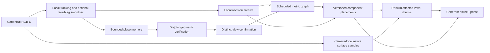

# Experimental causal RGB-D SLAM

The [online frontend follow-up](online_frontend.md) covers optical-flow recovery,
learned-feature experiments and native-depth processing performance.

SceneRecall now has a serial streaming coordinator that processes raw RGB-D,
maintains local estimation and historical place memory, schedules global graph
corrections, and synchronizes voxel reconstruction before publishing an update.
It is opt-in. Sparse odometry, the original local estimators, atlas forest and
offline graph experiments retain their defaults and scientific artifacts.
This is an integration milestone with explicit capacity and correctness limits,
rather than a claim of production robustness or camera-rate operation.

## Running the system

```bash
OPENBLAS_NUM_THREADS=1 OMP_NUM_THREADS=1 uv run --locked python \
  scripts/rgbd_slam.py --tum-path data/tum/rgbd_dataset_freiburg1_xyz \
  --map --output-dir outputs/online/xyz
```

Use `--eth3d-path` for processed ETH3D RGB-D or `--sens-path` for ScanNet.
`--start` and `--stop` select source inputs. Replay indices start at zero.
`--map` enables colored surface-voxel chunks with native pixel stride eight.
The system also accepts canonical observations directly:

```python
from scene_recall.mapping.voxel import MappingConfig
from scene_recall.slam.online import OnlineSLAM

slam = OnlineSLAM(calibration, mapping=MappingConfig(pixel_stride=8))
for observation in observations:
    update = slam.process(observation)
    # update.pose and update.component describe one explicitly named gauge.
    # update.local_pose remains in the uninterrupted local tracking segment.
    chunks = slam.reconstruction.snapshot()
```

There is no final graph solve when the stream ends. A pending solve remains
pending and is recorded in the report. `--no-recovery --no-loops` supplies the
matched local control. `--no-loops` isolates frontend recovery. `--retrieval mean`
and `--retrieval exhaustive_votes` supply retrieval controls. `--optimize-local`
enables the existing shared-landmark incremental smoother, including its original
measurement ownership and marginalization. It is disabled in this experimental
coordinator's default because earlier joint-state accuracy results remain mixed.

`--contrast clahe` selects fixed per-image contrast-limited adaptive histogram
equalization before SIFT detection and description. Its clip limit is two and
its tile grid eight by eight. Raw extraction remains the default. This option
changes image evidence used for association, while native depth, camera grids,
fusion colors and all geometric acceptance gates remain unchanged. It uses no
future observations or reference poses. The dark Sofa capture motivated this
additional development branch, so that capture is not a hidden validation set.

Controlled interventions use, for example, `--intervention depth --outage 20 50`.
Depth becomes NaN in that half-open interval. RGB intervention supplies black
images. Reports distinguish the original canonical source digest from the digest
of RGB-D actually delivered to the estimator. References are removed from
observations at the runner's estimator boundary and used only after processing.

## Architecture and coordinate ownership



`slam/online.py` owns ordering and publishes `OnlineUpdate`. Its map-to-local
transform is `T_component_local = T_component_depth @ inverse(T_local_depth)`.
Consumers can combine this transform with the active local tracker pose without
forcing a discontinuous global correction into the local motion model. Historical
placements can be queried again with `placement(frame)`. Previously returned
poses retain their original values, so callers can preserve emitted estimates.

Global correction changes published tracking placement and reconstruction during
the stream. It does not deform the active landmark map or inject graph poses as
new independent observations into the local smoother. The active frontend uses
native features in its own stable gauge. Nonkeyframes follow their preceding
received graph node. Only already received observations can change a historical
placement. There is no interpolation toward a future camera.

Tracking failure starts a new local segment. Historical loop constraints can
later connect that segment's gauge. They never relabel the original failed
transition, fill a black-image gap with predicted tracking, or silently align an
unconnected map. Component identifiers are graph root frame IDs.

`slam/recovery.py` tries up to three recent native-depth anchors over fifteen
inputs only after the established map and pairwise estimators fail. Source
depth and incoming RGB can support PnP through incoming depth dropout. Fitting
and verification use disjoint correspondence rows with the existing registration
gates. Conflicting accepted anchor poses abstain at 50 mm or 3 degrees. These
are engineering gates, not independent trials or calibrated probabilities.
An actual loss still discards active local state. The recent-anchor fallback
cannot reach through that reset. Historical reconnection is handled separately.

Place memory retains immutable feature snapshots, with the previous 64-entry,
16-recent deterministic retention policy. Mean RootSIFT signatures shortlist
twelve candidates. Mutual local descriptor voting reranks only that shortlist,
and at most four candidates undergo geometric verification. The same-segment
gap is thirty inputs and the cross-segment gap ten. The shortlist limits cost
but can exclude the correct place before verification. It is not a learned
place recognizer or a globally indexed descriptor database.

`LoopConfirmation` requires different source and target views in thirty-input
evidence cells, and abstains on verified explanations in disconnected source
components. The coordinator refreshes its connectivity from the solved graph,
and refreshes pending relations after local revisions. Rejection or explicit
revocation clears confirmation state, so stale evidence cannot authorize a
reconnection. This still cannot detect an exact geometric place alias.

## Optimization, provenance and reconstruction

The global graph retains immutable camera-to-camera loop measurements and local
segment identities. Local edges summarize the local estimator and never cross
a failure. Local revisions refresh those summaries, including graph nodes
attached to revised local keyframes. Raw loops remain unchanged. The original
graduated Geman-McClure objective and group information budgets are preserved.
Those budgets limit repeated-view information multiplication. Correlations
between groups and between loops and local summaries are still unmodeled.
No covariance or statistical independence claim is made for these summaries.

Global nonlinear solves occur at most once per ten inputs when new constraints
or local revisions require them. The default coordinator uses `block_pcg`, an
optional block sparse normal-equation solver added to `MetricPoseGraph`.
The original dense solver remains its default for all existing callers.
Only observed 6-by-6 blocks are stored. Block Jacobi preconditioning and a
checked residual tolerance govern CG. Failure increases nonlinear damping
through the existing solver policy. The nonlinear objective, robust exclusion,
and gauge reconstruction are shared with the dense reference.

This is scheduled sparse batch relinearization. It does not implement a Bayes
tree, incremental factorization, selective relinearization, or asynchronous
optimization. The default 512-node budget is explicit. Once exhausted, local
tracking and existing-node attachments continue, while new global nodes and
place queries stop. New segments retain separate gauges. The report marks this
degraded operation. Trajectory history, graph edges and reconstruction history
still grow within their respective recording and node limits.

`slam/reconstruction.py` samples native camera-local depth at admission. It
partitions history into chunks of at most 24 selected views, without crossing
local failures. Any changed camera pose or component marks its chunk dirty.
The chunk is fused again from its original samples with revised individual
camera poses. Moving a previously fused cloud rigidly would fail this contract
when the correction varies inside the chunk.

All affected chunks are prepared before their clouds are replaced. A failed
fusion retains pending invalidations and blocks a current snapshot. A successful
update stamps all clouds with the trajectory version, including unchanged
chunks. Revocation follows the same path. Fusion uses equal keyframe weighting,
and repeated rebuilding never increases a frame's support count. Saved samples
retain native depth origin, without claiming independent surface measurements.
The representation is surface voxels. Live TSDF subtraction/reintegration and
meshing are not implemented. Reconstruction history is in memory, without a
bounded persistent chunk store yet.

Scientific runs export the local `trajectory.npz`, revised `atlas.npz`, immutable
`atlas_emitted.npz`, raw graph constraints, verification events, per-input dirty
IDs and timings, and optional `reconstruction.npz` chunks with component IDs and
versions. Standard local archives keep failures and source-frame lineage.
Successful runs publish complete exports through staging. Failed raw processing
retains its pre-run protocol beside the requested output path.

## Research decisions

The [ORB-SLAM3 atlas](https://arxiv.org/abs/2007.11898) motivates preserving
independent lost-map gauges and requiring verified revisits before connecting
them. Its full covisibility and map welding machinery is not reproduced here.

[iSAM2](https://www.cs.cmu.edu/~kaess/pub/Kaess12ijrr.html) demonstrates why
incremental sparse factorization and selective relinearization matter for scale.
The block solver here is a dependency-free intermediate step with a dense
reference, rather than an implementation of iSAM2.

[SALAD](https://arxiv.org/abs/2311.15937) motivates replacing weak averaged
signatures with learned aggregated descriptors in a future controlled
retrieval comparison. The present shortlist preserves an auditable CPU path.

[MASt3R-SLAM](https://arxiv.org/abs/2412.12392) provides a compelling integrated
learned correspondence and revisable geometry design. Its pointmap scale and
cross-prediction correlations require a different measurement contract from
native metric depth. No learned pointmap is added as an independent depth factor.
The available NVIDIA driver could not initialize during this investigation.
No learned weights or external SLAM implementation were imported, and no matched
competitor performance claim is made.

## Evaluation protocol

The ignored study root is `outputs/online_slam/`. A frozen JSON manifest drives
raw subprocess runs through `experiments/online_slam_study.py`. The natural
matrix covers full TUM XYZ and RPY, a 600-input Pioneer prefix, a Walking Static
window, a ScanNet window and a newly downloaded full ETH3D Sofa 3 recording.
These are six independent recordings. Existing recordings are development
evidence rather than hidden tests. Short interventions and the optional local
smoother comparison share XYZ and must not be counted as independent scenes.
The official Sofa image and depth archive URLs and SHA256 hashes are retained.

Each comparison freezes original and delivered inputs, configurations, source
identity and frame population before scoring. Availability is reported through
local failed transitions and root-component frame counts. Correctness is scored
with root-anchored translation and rotation error in each component, without
position alignment. Singleton component zero error is uninformative. Comparisons
also score the intersection of root-connected frames so added availability
cannot masquerade as improved accuracy. Original per-transition local RPE and
position-aligned segment ATE remain in standard reports with their own scope.

Causal emitted placements and the final revised historical archive are scored
separately. An earlier camera corrected when a loop arrives is a valid online
revision, but it is not the estimate emitted when that camera arrived.
Verification residuals, graph innovation and reference inconsistency are distinct
quantities. External loop errors do not provide physical correspondence labels,
and low graph cost cannot certify a bridge between disconnected gauges.

`experiments/evaluate_online_maps.py` freezes the first 24 cadence-ten fusion
candidates and interleaved reference target cameras. Missing fixed training
references withhold that map comparison without replacement. Targets are
withheld from fusion, but their inputs can enter tracking and loop estimation.
Depth interventions also remove the corresponding fusion samples. The score
caps absolute error at 200 mm and gives that penalty to missing predictions,
with coverage and explained fraction reported separately. Reference-pose fusion
is diagnostic, not independent physical surface truth. All saved chunks are
also checked exactly against fresh fusion at the final online placements.

Raw matrix timings include reading, extraction, tracking, retrieval, scheduled
solves and reconstruction. Concurrent runs are profiles. Isolated serial runs
and graph controls are needed to establish latency or memory comparisons.

For another recording, prepare a manifest such as:

```json
{
  "example": {
    "dataset": "tum_rgbd",
    "source": "data/tum/rgbd_dataset_freiburg1_xyz",
    "stop": 200,
    "policies": ["local", "online", "clahe"]
  }
}
```

```bash
OPENBLAS_NUM_THREADS=1 OMP_NUM_THREADS=1 uv run --locked python \
  experiments/online_slam_study.py --manifest local_inputs/cases.json \
  --output-dir outputs/online_study --workers 1

uv run --locked python experiments/evaluate_online_maps.py \
  --run outputs/online_study/example --policies local online clahe \
  --output-dir outputs/online_study_maps
```

The current evidence selection is recorded in
`outputs/online_slam/final_selection.json`. The primary and contrast matrices
remain separate. Selected paths link to original raw runs or the explicitly
corrected verification replays. Failed exact-audit protocols and logs remain
retained alongside successful evaluations. The corrected replays preserve the
original emitted trajectories exactly, so their availability and causal errors
are unchanged by the roundoff repair.

## Complete-pipeline evidence

The primary raw matrix processes 3,119 distinct natural inputs from six
recordings. The fixed contrast follow-up adds the previously unused 285-frame
ETH3D Camera Shake 3 capture, bringing the distinct natural population to
3,404 inputs from seven recordings. Windows and interventions from one capture
are not independent replicates. No settings were tuned on Camera Shake 3.

The following table compares the unchanged local control with the raw-image
online coordinator. Root counts describe emitted availability. Errors use the
intersection of root-connected frames under all policies in that case.

| Population | Inputs | Local failures, control / online | Emitted root frames, control / online | Matched emitted translation RMSE, control / online, mm |
| --- | ---: | ---: | ---: | ---: |
| XYZ full | 792 | 0 / 0 | 792 / 792 | 80.84 / 24.50 |
| RPY full | 694 | 1 / 1 | 115 / 684 | 72.48 / 70.17 |
| Pioneer prefix | 600 | 154 / 114 | 69 / 69 | 22.01 / 22.85 |
| Walking Static | 300 | 0 / 0 | 300 / 300 | 72.23 / 62.75 |
| ScanNet 1000:1200 | 200 | 0 / 0 | 200 / 200 | 80.26 / 73.22 |
| Sofa 3, raw | 533 | 532 / 501 | 1 / 1 | Uninformative singleton |

RPY's matched error population has 115 frames. The full online emitted root
scores 70.30 mm, while the final revised root contains all 694 inputs and scores
66.41 mm. Its 192 active loops have 189 reference-scored endpoint pairs. Eight
exceed 10 cm or 5 degrees. A geometrically verified constraint can still be
externally inaccurate, and robust graph fitting does not remove every such
factor. The original RPY local poses and statuses reproduce the saved control
exactly.

Pioneer adds forty accepted transitions relative to the local control. Their
reference relative translation RMSE is 34.07 mm, and one exceeds the joint
10 cm / 5 degree threshold. The root remains only 69 frames, and root accuracy
slightly worsens. This is useful local availability without a solution to global
fragmentation. Raw Sofa adds 31 transitions with 16.13 mm reference translation
RMSE and no threshold violation, but still fails to reconnect its initial root.
The raw local Sofa control exhausts the 512-node global budget before its final
input. Local processing continues with explicitly disconnected later gauges.

Full XYZ retains the same 792 root-connected frames and zero local failures.
Its matched local control reproduces the previous scientific poses, statuses,
segments, references and source lineage exactly. Emitted root-anchored
translation RMSE falls from 80.840 to 24.498 mm, with rotation RMSE falling from
1.464 to 0.983 degrees. The final revised historical archive scores 24.744 mm
and 1.027 degrees. These emitted and revised results remain separate.

The fixed first-24-view XYZ surface score worsens from 43.725 to 46.902 mm.
Coverage changes from 95.43% to 95.35%. Every saved chunk matches fresh raw
fusion exactly, across eighty admitted views under each policy. The system
therefore delivers consistent revisions while exposing a remaining external
geometry regression.

RPY's surface score improves from 89.96 to 73.58 mm when root reconnection
admits 24 training views instead of twelve. On the same twelve-view training
intersection it changes only from 89.96 to 89.58 mm. Most of this map improvement
therefore comes from recovered coverage. All seventy admitted depth views per
policy were checked against the saved reconstruction, across four chunks each.

The black-RGB intervention at inputs 20:30 retains eleven local failed
transitions under both methods. Emitted root availability increases from twenty
to 105 frames and later revisions connect 110. The ten blank-image inputs remain
unconnected. The depth intervention at 20:50 causes no local loss under either
method, while emitted translation RMSE changes from 18.01 to 16.57 mm. It removes
the corresponding fusion samples and does not synthesize metric depth.

The optional joint local smoother was exercised across multiple lag boundaries
on the same 160-input XYZ population. With zero losses under both methods,
emitted translation RMSE changes from 17.98 to 16.23 mm and final revised error
from 18.16 to 17.61 mm. This bounded development result does not supersede the
earlier mixed full-sequence and cross-scene joint-state evidence.

### Contrast diagnosis

Sofa's initial image intensity median is sixteen. The first two raw images
produce sixteen and 21 SIFT features, with fourteen and nineteen valid native
depth anchors. Fixed CLAHE produces 100 and 83 features, with ninety and 75
native anchors. The unchanged geometric verifier still decides acceptance.

Across the full Sofa recording, contrast normalization reduces local failures
from 501 to 133. Its 368 newly accepted transitions have no 10 cm / 5 degree
reference violation. Emitted root availability increases from one to 211 frames,
and final revised availability reaches 278. The final root translation RMSE is
32.87 mm. Raw extraction's singleton zero error is not a meaningful accuracy
comparator. This is a substantial availability gain with separately measured
correctness, and substantial fragmentation remains.

The fixed policy transfers unevenly:

| Recording | Raw / CLAHE failures | Emitted root frames, raw / CLAHE | Matched emitted translation RMSE, raw / CLAHE, mm |
| --- | ---: | ---: | ---: |
| Sofa 3 full | 501 / 133 | 1 / 211 | Uninformative singleton intersection |
| Camera Shake 3 full | 197 / 177 | 6 / 10 | 13.49 / 17.92 |
| XYZ 160 | 0 / 0 | 160 / 160 | 17.98 / 15.70 |
| RPY 300 | 1 / 0 | 290 / 300 | 73.24 / 71.35 |

Camera Shake adds 26 accepted transitions but introduces six new failures. Its
largest final component grows only from 35 to 38 inputs, and neither method
closes an active global loop. The six-frame error intersection cannot establish
robust full-capture localization. RPY's final revised error changes from 69.58
to 55.90 mm, with externally inaccurate active factors falling from seven to
four under the same 10 cm / 5 degree criterion. These are mixed transfer results,
so contrast normalization remains opt-in.

Sofa's fixed root map score changes from 140.62 to 55.91 mm with contrast enabled.
This includes a larger recovered training population. Camera Shake's score
remains 151.12 mm because only the first training view belongs to the root under
either method. XYZ 160's map score worsens from 47.29 to 48.47 mm despite improved
trajectory error. More available or more accurate camera poses do not guarantee
a better externally scored surface.

Other primary surface results reinforce that distinction. ScanNet improves
from 68.96 to 65.58 mm. The RGB outage improves from 63.74 to 52.15 mm as root
coverage recovers, but its equal-training comparison slightly worsens to
63.99 mm. The depth outage worsens from 50.93 to 51.82 mm. The joint-local
160-frame comparison improves from 47.29 to 46.76 mm. Walking's fixed map
comparison is withheld for missing training references, without replacing views.

### Revision audit and reproducibility

The complete-pipeline audit exposed a roundoff issue in the first fragmented
runs. A subthreshold change could be published without invalidating its chunk.
The measured discrepancies were 2.22e-16 m on Pioneer and 6.02e-13 m on Sofa.
Publication now retains the previous bitwise pose whenever the existing
1e-12 invalidation threshold treats a placement as unchanged. A regression test
exercises this boundary. Fresh Pioneer and contrast-Sofa replays verify the
corrected implementation. Initial artifacts remain retained and labeled.

The evaluator defaults to exact array checks. Its explicit
`--audit-tolerance-m` option is available for auditing the initial artifacts,
and records both the requested bound and measured discrepancy. Integer voxel
keys, frame support, colors, gauges and versions must still match exactly.
The scientific outputs are never silently rewritten to repair a failed audit.

Source snapshots preserve the initial, pre-contrast, contrast and corrected
package versions, with individual run hashes. A repeat of raw Sofa reproduces
the original poses and statuses exactly after the contrast option was added.
The original validated local estimators and earlier study outputs are retained.

### Performance and causal repeat checks

Separate serial subprocesses ran XYZ 160 with mapping under mean, shortlist
voting and exhaustive voting, then repeated them in reverse order. The host was
an Intel i7-13700HX with single-thread OpenCV, OpenBLAS and OMP. Every run
extracted its own features from raw images. Export and reference scoring are
excluded from the pipeline wall time. Per-input process latency excludes reader
time, while throughput includes it.

| Retriever | Pipeline seconds, two runs | Throughput, inputs/s | Process p95, seconds |
| --- | ---: | ---: | ---: |
| Mean | 53.04–62.94 | 2.54–3.02 | 0.93–1.03 |
| Shortlist voting | 62.65–68.94 | 2.32–2.55 | 1.40–1.58 |
| Exhaustive voting | 66.88–67.51 | 2.37–2.39 | 1.64–1.67 |

Peak process RSS is approximately 214–218 MiB in these short runs. Repeated
estimates match exactly for each method. Shortlist and exhaustive voting produce
identical emitted arrays on this probe. Their throughput ranges overlap, so
this experiment does not establish an overall throughput advantage. The
shortlist limits expensive matching and lowers observed tail latency here.
It can still miss places excluded by its weak first stage. Mean reaches
18.43 mm emitted translation RMSE on the probe, compared with voting's 17.98 mm.

The corrected implementation's raw 80-input replay reproduces the first eighty
emitted cameras of the original full XYZ run exactly, including component IDs,
source lineage and versions. It does not reproduce the future-revised history
as if that history had been emitted earlier.

Isolated synthetic graph subprocesses use the same biased chain and correct
loop factors under both linear solvers:

| Nodes | Dense / block solve, seconds | Dense / block peak RSS, MiB |
| --- | ---: | ---: |
| 96 | 0.262 / 0.204 | 60.7 / 49.0 |
| 192 | 0.847 / 0.746 | 93.1 / 49.6 |
| 384 | 3.029 / 2.503 | 176.0 / 51.3 |

Both solvers retain the same active loop sets. Maximum absolute pose-matrix
entry differences are below 4.3e-6 across these controls. They are numerical
agreement checks, not bitwise solver identity. These are one solve per
configuration, include process RSS rather than isolated matrix allocation, and
do not exercise every conditioning or outlier regime. The block representation
substantially reduces memory on this sparse control, while nonlinear solving
and complete-pipeline latency still preclude camera-rate operation.

The final Linux suite passes 984 tests, including reference independence,
prefix causality, recovery ambiguity, graph budget degradation, revocation,
local/global revision propagation, raw-input provenance, atomic scientific
export, failed reconstruction retry and dense/block solver agreement.
Ruff checks, formatting and whitespace checks pass. All 5,183 protected older
scientific files retain their SHA256 hashes, and every matrix package hash has
a complete retained source archive. No dependency or lockfile changed. Native
Windows and hosted CI were not run. No commit was created.

## Remaining limitations

The system has no inertial prediction or photometric/dense tracking fallback.
Rapid rotation with little valid RGB support can still fragment tracking.
Depth dropout can be tracked from retained source depth while correspondences
survive, but cannot create new metric structure. Recent-anchor support, place
retrieval, exact aliases, correlated sensor bias and false bridges remain
correctness bottlenecks. Native depth, calibration and exposure timing still
limit geometry even when graph optimization converges.

The next architectural priorities are independently evaluated learned
correspondence/retrieval, explicit geometric ambiguity handling across maps,
incremental sparse nonlinear optimization, and a persistent revision-aware chunk
store. Promotion requires stronger continuity and false-association evidence
across additional captures and sensors, plus bounded processing latency.
