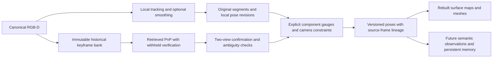

# Verified localization recovery and explicit map relationships

This experimental follow-up separates local tracking, historical localization,
and global map consistency. Sparse remains the production default. The original
incremental SLAM settings remain unchanged. The new atlas is an opt-in overlay
used by research drivers, without a new production backend or automatic map
fusion policy.

The [system investigation](slam_system_investigation.md) showed that local
optimization cannot repair absent correspondences, and that lower internal
residuals need not improve external poses. Recovery therefore needs persistent
observations outside the active optimization window, an explicit representation
of disconnected coordinate frames, and evidence for relating those frames.

## Implemented components

`scene_recall.slam.registration` provides two complementary registrations.
Both use mutual SIFT matching, a fixed even/odd correspondence split, and a
frozen fit verified on measurements excluded from estimation and refinement.

* Pairwise RGB-D registration fits a unit-scale rigid transform from source and
  target depth points using seeded triplet RANSAC and Kabsch alignment.
  Collinear hypotheses are rejected. Held-out metric distances and
  bidirectional image projections verify the transform.
* Historical anchor registration fits source-depth-to-target-image PnP.
  Target depth is checked wherever available, without requiring depth at every
  incoming keypoint. This matters when current depth support is sparse.

The default gates require 12 matches, at least six fitting and six verification
inliers, 50% support, distributed image occupancy, and a bearing-information
check. Metric tolerance is 30 mm plus 1% of depth. Image tolerance is 3 pixels.
These are engineering gates. They are neither calibrated likelihoods nor
certificates of correct place identity. Separate correspondence rows can still
share sensor bias, descriptors, surfaces, and depth neighborhoods.

`scene_recall.slam.atlas.SubmapAtlas` retains raw measurement snapshots after
local tracking resets. The retrieval bank holds at most 64 keyframes, with 16
recent entries and a deterministic historical sample. Frame zero is retained
when it has sufficient depth support. Mean RootSIFT appearance ranks up to four
candidates at five-frame cadence and at tracking boundaries, with a ten-frame
minimum separation. The bank owns immutable copies of its measurements.

A successful image registration creates a tentative map relationship. Joining
two components requires a second source frame and a second target frame, with
segment transforms agreeing within 50 mm and 3 degrees. Reusing the same source
or target does not confirm a link. If verified candidates belong to multiple
disconnected components, the query abstains. This is deliberately conservative
and can reject legitimate connections between fragmented maps.

The atlas retains one verified camera constraint per forest edge. It does not
average correlated pairwise estimates. It checks redundant cycles but does not
optimize loops or distribute drift. Each component has an independent metric
gauge rooted at its earliest local segment. A component connection preserves
all original local segment IDs and failed transition statuses.

For camera-to-segment poses `L_a`, `L_b` and a measured source-to-target camera
transform `Z_ba`, the map relation is
`T_segment_a_segment_b = L_a @ inverse(Z_ba) @ inverse(L_b)`.
The camera constraints survive local pose revisions. Rebuilding the forest from
the revised camera poses updates affected map transforms and increments the
atlas version. Local revisions also invalidate geometry within an unchanged
root gauge. Atomic validation rejects invalid revision batches before mutation.

`revoke(source, target, reason)` explicitly removes a forest constraint,
recomputes the disconnected gauges, clears stale pending hypotheses, and reports
the affected segments with a new version. It does not automatically diagnose a
wrong place or permanently blacklist future observations of that place.



The active retrieval bank is bounded. Frame history, output records, and the
accepted forest grow with a run. This prototype does not establish constant
total memory, cross-session identity, persistence across process restarts, or a
real-time service. It provides the representation and exported constraints for
those later components.

## Controlled comparison

`experiments/slam_recovery.py` evaluates five selectable policies:

| Policy | Local estimator change |
| --- | --- |
| `control` | Original incremental frontend with optimization disabled |
| `native` | Original incremental SLAM with optimization enabled |
| `low_pnp` | After existing estimators fail, retry PnP with 12 correspondences and eight inliers |
| `rgbd` | After existing estimators fail, try withheld-verified RGB-D rigid registration |
| `rgbd_native` | Same RGB-D fallback with original local smoothing enabled |

The lower-support PnP policy is a threshold control. It has no disjoint
verification requirement. The RGB-D policy requires depth in both endpoints,
which can make it less available than PnP. The atlas receives the same local
outputs and never feeds an atlas pose into the local estimator. This isolates
local maintenance from historical localization and avoids counting a later
connection as a successful adjacent transition.

Reference poses are stripped before estimation. They are used afterward to
score trajectories, accepted fallback transforms, and accepted atlas edges.
Report component coverage together with error. A short segment can have a low
aligned ATE while almost the entire capture remains disconnected. Per-component
root alignment also cannot demonstrate accuracy between disconnected components.

Each run saves a pre-replay protocol, source and driver hashes, canonical input
identity, original local trajectories, atlas events, accepted camera constraints,
and both causal and final atlas poses. `atlas_emitted.npz` records the component
and version available at each input. `atlas.npz` includes later corrections to
historical frames. These are different evaluation populations.

The tests include counterexamples to overly strong interpretations of these
checks. A shared 10% depth-scale error survives both registrations and biases
translation by 10%. Two physically different places with exactly the same
measured appearance, geometry, and local motion can pass separate-view
confirmation. Rejecting ambiguity among retrieved components helps only when
the competing explanation is present. Confirmation is evidence of consistency,
without establishing physical place identity.

## Reconstruction protocol

`experiments/evaluate_recovery_maps.py` evaluates the accessible first-root map.
It fixes the first 24 cadence-10 training candidates and interleaved targets
before inspecting localization or reference availability. Local-only maps admit
training candidates in the original first segment. Atlas maps admit candidates
connected to that root after the run. Disconnected poses are never invented.

Surface voxels use 20 mm cells, stride-eight native depth samples, and 10 mm
rendering discs. TSDF uses 20 mm cells and 60 mm truncation. All maps render at
the same withheld reference camera poses. Reference-pose fusion uses every fixed
training candidate as a geometry control. Missing training references withhold
the comparison, rather than silently changing its training population.

Coverage, fraction explained within 50 mm, common-mask error, and a 200 mm
missing-depth penalty measure different effects. More connected views can
increase coverage while spreading pose bias into existing geometry. This new
root-map protocol does not replace the original per-segment reconstruction
cohorts or relax their comparison safeguards.

## Evaluation on 2026-10-21

The main comparison covers 13 natural populations from eight indoor recordings
in TUM, ScanNet, and ETH3D. There are 4,752 distinct canonical inputs. The full
830-frame Pioneer replay overlaps its two 300-frame windows, and repeated
policies and outages do not add independent data. The three ETH3D populations
were selected before downloading or inspecting their algorithm scores. They are
new recordings for this investigation, drawn from the official training data.
They are not a hidden benchmark test set.

| Natural population | Frames | Control losses | Lower-PnP losses | RGB-D losses | Control first-segment frames → atlas root frames |
| --- | ---: | ---: | ---: | ---: | ---: |
| XYZ, Desk, two ScanNet windows, two Walking windows | 2,365 across six runs | 0 | 0 | 0 | Continuous throughout each run |
| RPY | 694 | 1 | 0 | 1 | 115 → 694 |
| Pioneer 0:300 | 300 | 113 | 79 | 112 | 69 → 69 |
| Pioneer 400:700 | 300 | 41 | 14 | 41 | 70 → 70 |
| Pioneer full | 830 | 253 | 152 | 246 | 69 → 69 |
| ETH3D lab | 263 | 77 | 43 | 68 | 1 → 1 |
| ETH3D repetitive 0:300 | 300 | 0 | 0 | 0 | 300 → 300 |
| ETH3D repetitive 1400:1700 | 300 | 53 | 50 | 46 | 1 → 1 |

These counts separate maintenance from recovery. The atlas joins the two RPY
segments without erasing their failed transition. Its selected connection has
12.1 mm translation error and 0.48° rotation error. The complete connected RPY
trajectory still has 118.7 mm root-anchored translation RMSE and 7.96° rotation
RMSE. A correct connection does not correct later drift within a local segment.

The lower-PnP control has a substantial availability gain on Pioneer, with a
cost in correctness. Its full replay accepts 86 fallback motions, three outside
10 cm or 5°. Ten-frame translation RPE on exactly the same 425 endpoint pairs
worsens from 97.7 to 105.1 mm. The RGB-D fallback accepts seven motions, none
outside that threshold, and leaves common-pair RPE unchanged. Net loss reduction
and accepted fallback count differ because a recovery changes subsequent local
tracking state. Small aligned ATE values on surviving segments do not measure
accuracy across the missing intervals.

Original local smoothing remains inconsistent on the fresh camera. On early
ETH3D repetitive, native SLAM improves ATE from 7.44 to 3.29 mm and ten-frame
translation RPE from 7.13 to 4.03 mm. On the later window, it worsens ATE from
12.57 to 15.27 mm and ten-frame RPE from 11.85 to 16.21 mm. No new residual
weights or gates were selected from these scores. The coupled RGB-D/native
experiment reduces lab losses from 77 to 68, while Pioneer 400 remains at 41.

### Where recovery stops

Pioneer failed transitions have median 804 image features, 26 depth-supported
features, nine source-depth matches, and four matches with depth at both ends.
Of 253 failed transitions, 252 have fewer than 20 source-depth matches. The
largest detected feature set is below the 1,500-feature cap. Increasing that
cap alone cannot address this observed failure population.

Expanding retrieval from four to all 64 retained candidates produces 18,371
rejected registrations, of which 18,159 lack disjoint anchor support. Confirmed
connections increase only from one to two, without increasing the 69-frame
initial component. This is not evidence that retrieval is solved. At input 645,
two geometrically accepted initial-map candidates rank 61st and 62nd under mean
RootSIFT. A post-hoc reference-neighborhood audit also finds rejected candidates
near earlier camera poses. Pose proximity is an opportunity proxy, without
guaranteeing image overlap or correct visibility. The full capture ends 2.23 m
and 106.4° from its initial reference pose, so its name does not establish a
closed endpoint loop.

The optional `confirmation_query_frames=10` policy directs queries toward
tentative source segments for ten frames after the latest hypothesis or its
replacement. Its geometry gates, retained keyframe
population, and local trajectories stay fixed. Default zero preserves the
original five-frame schedule. On Pioneer it increases connections from one to
five at budget four, and to six at budget 64. The initial component still stays
at 69 frames. New edges include errors up to 58.6 mm and 2.71°, so faster
confirmation is not an unconditional accuracy improvement.

On the fresh early ETH3D outage, directed confirmation reduces recovery latency
from five frames to one, approximately 184 ms to 37 ms at its source cadence.
The connection remains close to 3.8 mm translation
error. The late repetitive and lab populations gain no connections. A singleton
source segment cannot satisfy the current two-distinct-source requirement, even
if an incoming view is recognizable. Root coverage of one frame must therefore
be read alongside the largest component, which has 247 frames in late repetitive
and 82 in the lab. Choosing map readiness and retention jointly with verification
requirements is an unresolved architectural issue.

The RPY cycle audit exactly replays 74 accepted registrations, with 73 scorable
reference pairs. Among 64 scorable inconsistent cycles, registration error is
34.6 mm and 2.22° RMSE. Disagreement with the accumulated atlas is 97.4 mm and
5.62°. None exceed 10 cm or 5° of registration error, but 63 exceed 20 mm or 1°.
This suggests both accumulated drift and material registration bias. It supports
uncertainty-aware robust global estimation, without treating all verified image
constraints as exact. Reference poses enter only this diagnostic scoring.

A graph with one rigid node per original segment cannot correct time-varying
drift inside that segment. A future global backend needs historical keyframe
corrections, or smaller revisable map units, together with reconstruction
invalidation. Loop measurements also share native observations with the local
estimator. Treating them and locally condensed poses as independent factors can
double-count information. Joint replay or correlation-aware condensation is a
more defensible next study than attaching exact loop transforms to the forest.

### Downstream reconstruction

The table uses the fixed first-root TSDF protocol. Error includes a 200 mm
penalty for missing predicted depth. Increased coverage is an intended benefit
of reconnecting maps, rather than a comparison with identical admitted views.

| Population | Local-only mesh coverage | Atlas mesh coverage | Local-only penalized error | Atlas penalized error | Reference-fusion error |
| --- | ---: | ---: | ---: | ---: | ---: |
| Natural RPY | 68.3% | 87.5% | 98.8 mm | 71.8 mm | 43.3 mm |
| XYZ 80, RGB outage | 74.1% | 85.8% | 62.9 mm | 42.5 mm | 36.8 mm |
| Desk, RGB outage | 28.2% | 90.3% | 154.7 mm | 55.3 mm | 37.8 mm |
| Fresh repetitive early, RGB outage | 57.7% | 91.8% | 125.3 mm | 27.8 mm | 23.7 mm |
| Fresh repetitive late | 16.3% | 16.3% | 175.0 mm | 175.0 mm | 34.0 mm |

On natural RPY, avoiding the local failure through lower-threshold PnP yields
85.3 mm penalized mesh error, worse than the atlas control's 71.8 mm. More
continuous tracking alone does not guarantee the best reconstructed map.
Surface-voxel and mesh results also differ. In XYZ's outage, point-surface
coverage improves from 81.3% to 89.9%, while common-mask error worsens from
13.7 to 23.4 mm and the fraction explained within 50 mm slightly decreases.

Walking and lab root-map comparisons are withheld because fixed training
references are missing. No training views are silently dropped to obtain a
score. The Walking outage connects 290 frames but its selected edge has an
unreferenced source frame, so it has no direct edge-accuracy score. Missing
references are not counted as correct connections.

The outage gains generalize to a new camera and recording, but do not establish
robust recovery through long absences, outdoor motion, lighting or seasonal
change, cross-session revisits, or arbitrary dynamic scenes. All parameters stay
experimental and production defaults remain unchanged.

### Computational limits

An isolated raw-image experiment replays 80 XYZ inputs with the same outage in
fresh processes, once in each policy order and its reverse. OpenCV, OpenBLAS
and OMP use one thread on an Intel i7-13700HX. No feature cache is supplied.
Opposite-order runs reproduce all saved scientific arrays exactly.

| Policy | Mean processing and atlas time | p95 | Peak process RSS |
| --- | ---: | ---: | ---: |
| Control without atlas | 230.6–232.7 ms | 482–490 ms | 158.8–158.9 MiB |
| Control with atlas | 239.4–240.7 ms | 530–537 ms | 167.9–168.1 MiB |
| Lower-PnP with atlas | 245.7–253.5 ms | 557–570 ms | 167.9–168.0 MiB |
| RGB-D fallback with atlas | 244.9–248.6 ms | 570–573 ms | 167.0–167.3 MiB |
| Native smoothing with atlas | 250.9–273.8 ms | 606–646 ms | 168.0–168.8 MiB |

Processing includes raw feature extraction and estimator/archive/atlas work.
Image decoding and canonical-input verification add roughly another second per
80-input replay. These are short, warm-source CPU profiles, without a real-time
claim or long-run memory bound. The bank reaches only 14 entries in this clip.
All gates reject the empty outage packets, so this timing population does not
characterize every successful fallback or large historical search. Concurrent
accuracy-run timings are diagnostic and are not used for speed comparisons.

## Reproduction

Choose fresh ignored output directories. The baseline cache driver supports
TUM and processed ETH3D sources. Existing canonical runs can also be replayed
directly, including ScanNet. Omit `--features` for raw feature extraction.

```bash
OPENBLAS_NUM_THREADS=1 OMP_NUM_THREADS=1 uv run --locked python \
  experiments/cache_slam_baseline.py \
  --sequence-path /path/to/rgbd_dataset_freiburg1_xyz \
  --stop 300 --output-dir outputs/recovery_inputs/xyz

OPENBLAS_NUM_THREADS=1 OMP_NUM_THREADS=1 uv run --locked python \
  experiments/slam_recovery.py \
  --baseline-run outputs/recovery_inputs/xyz/budget \
  --features outputs/recovery_inputs/xyz/features.npz \
  --policies control native low_pnp rgbd \
  --output-dir outputs/recovery/xyz

OPENBLAS_NUM_THREADS=1 OMP_NUM_THREADS=1 uv run --locked python \
  experiments/slam_recovery.py \
  --baseline-run outputs/recovery_inputs/xyz/budget \
  --features outputs/recovery_inputs/xyz/features.npz \
  --policies control low_pnp rgbd --outage 40 50 \
  --output-dir outputs/recovery/outage_xyz

OPENBLAS_NUM_THREADS=1 OMP_NUM_THREADS=1 uv run --locked python \
  experiments/evaluate_recovery_maps.py \
  --run outputs/recovery/outage_xyz \
  --output-dir outputs/recovery/maps_outage_xyz
```

The outage replaces RGB with black and supplies the corresponding empty feature
packet during the half-open interval. Original depth remains available to map
evaluation. It is a controlled recovery intervention, not an estimate of natural
failure frequency. `--no-atlas` is an exact local-estimator isolation control.

`experiments/atlas_retrieval_ablation.py` replays fixed, unrevised local poses
with candidate budgets four and 64. It changes retrieval effort without changing
matching gates, raw observations, local tracking, or reference access.

`experiments/atlas_confirmation_ablation.py` checks the optional directed
confirmation policy. It first reproduces the original four-candidate atlas
arrays exactly and asserts the same retained keyframes throughout the replay.
`experiments/audit_atlas_cycles.py` reconstructs accepted cycle transforms from
the same features and verifies every stored registration diagnostic exactly.
Its reference-free `cycle_constraints.npz` packet is separate from the external
reference scoring report.

The study artifacts live under `outputs/slam_recovery/`. Original experiment
reports and arrays remain intact. `verified_exports/` provides standard run
directories with inherited input-report timing and factor summaries labeled as
context. Per-frame diagnostics, trajectories, atlas arrays and comparisons are
copied unchanged and checked by SHA256. `source_before_confirmation.tar.gz`
preserves the initial evaluation implementation before the optional scheduling
and revocation extension. The final evidence manifest fingerprints executed
protocols, source capsules, inputs and selected results. Development pilots,
incomplete runs and the first lab reference-setting diagnostic are excluded from
the main conclusions.

Verification finishes with 936 passing tests, clean Ruff checks, and exact
default pose/segment/status agreement on restored XYZ, Desk, RPY, and both
ScanNet populations. Atlas on/off leaves the controlled local trajectories
identical. SHA256 checks preserve all 1,429 previous study scientific files and
16 protected capsule/manifest files. No commit is created by these experiments.

## Processed ETH3D support

`ETH3DReader` accepts the processed registered RGB-D format documented by the
[BAD SLAM authors](https://github.com/ETH3D/badslam#dataset-format). It reads
`calibration.txt` as `fx fy cx cy`, uses native image dimensions, replicates
grayscale into canonical RGB, and decodes uint16 depth at 5000 units per meter.
Unequal RGB/depth grids and unsupported image encodings are rejected. Raw,
unrectified, and stereo variants are outside this adapter's contract.

The official mono archive contains images, calibration, and reference poses.
The RGB-D companion supplies depth and its timestamp table. Extract both into
the same sequence directory. Reusing only the RGB-D archive leaves an incomplete
source. The adapter reuses strict timestamp association and bounded reference
interpolation, without pose extrapolation.

```bash
uv run --locked python scripts/rgbd_odometry.py \
  --eth3d-path /path/to/sfm_lab_room_1 --backend sparse \
  --tum-max-ground-truth-difference-s 0.1 \
  --output-dir outputs/odometry/eth3d_lab
```

The inherited `--tum-*` association options also apply to ETH3D. The fresh lab
sequence has 263 reference samples about 73.7 ms apart, offset from image stamps
by at most 48.4 microseconds. A 50 ms maximum bracket wrongly withholds almost
every reference. Its explicit 100 ms evaluation setting preserves interpolation
and boundary missingness. This changes reference availability, without supplying
reference poses to tracking. The original 50 ms run remains a diagnostic artifact.
Lab references are derived from SfM and are not independent motion capture.

## Architectural priorities

The follow-up [verified loop graph investigation](slam_loop_graph.md) implements
an optional descriptor-vote retriever and a separate revisable metric keyframe
graph. It evaluates both genuine spatial corrections and failures across the
same recordings, with explicit false-cycle controls and reconstruction rebuilding.
The original forest and local tracking defaults described here remain unchanged.

Historical localization and explicit map relationships are useful foundations
for persistent spatial memory even when local BA remains unreliable. Surface
fragments and future object observations should retain source-frame lineage and
local coordinate frames. Revised transforms can then move their placement without
silently treating an earlier global location as immutable truth.

The multi-map reuse in [ORB-SLAM3](https://arxiv.org/abs/2007.11898) motivates
separating lost tracking from permanent loss of earlier maps. This prototype
does not reproduce its vocabulary, covisibility optimization, inertial estimator,
or map-merging algorithm. [TEASER](https://arxiv.org/abs/2001.07715) is a promising
alternative robust 3D registration method when outlier correspondences dominate.
A registration optimum alone cannot identify a geometrically consistent wrong
place or recover depth measurements that do not exist. No TEASER code is imported.

The next development priorities depend on the measured bottleneck:

1. Preserve more useful metric anchors through depth-aware feature selection,
   longer-lived tracks, and spatially distributed support. Measure accepted
   transition error and map quality along with tracking coverage.
   Pooling distinct anchors across covisible historical views is a particularly
   useful next comparison against the current pairwise verifier. Deduplicate
   feature observations and retain their correlated pose/depth uncertainty.
2. Improve place retrieval recall with a covisibility-aware vocabulary or learned
   retrieval, then verify matches across viewpoint and time. Evaluate repeated
   places and disconnected-map ambiguity separately from known-place recall.
3. Introduce reversible robust global constraints only after false-connection
   behavior is measured. A forest avoids correlated averaging, but one wrong
   accepted edge can still misplace an entire component. A future graph needs
   uncertainty, contradictory-evidence handling, and integration of explicit
   edge revocation with its optimizer and reconstruction consumers.
4. Add dense geometric or photometric evidence only with degeneracy and sensor
   consistency checks. Depth dropout, dynamic surfaces, exposure changes, and
   calibration bias can affect multiple residuals coherently.
5. Separate persistent static scene evidence from moving objects and transient
   appearance. Semantic descriptors can aid retrieval, while observation lineage
   and geometric verification remain necessary for spatial memory.

These directions are architectural inferences from the experiments. The separate
follow-up now supplies experimental loop optimization. Learned retrieval,
dynamic-object modeling, inertial fusion, calibrated uncertainty, cross-session
memory, and production recovery remain unimplemented.

The broader literature suggests three useful controlled next comparisons:

| Direction | Relevant primary work | SceneRecall experiment that would test its value |
| --- | --- | --- |
| Learned correspondence with existing metric depth | [DROID-SLAM](https://arxiv.org/abs/2108.10869) combines learned updates with dense pose/depth adjustment | Replace correspondence proposals while retaining native depth, fixed calibration, verification cohorts, and local/global separation |
| Learned two-view 3D prior | [MASt3R-SLAM](https://arxiv.org/abs/2412.12392) builds tracking, fusion, relocalization, and global optimization around pointmap predictions | Test retrieval and matching first, then compare predicted geometry against native depth on unfamiliar cameras and scenes |
| Robust metric-semantic graph | [Kimera2](https://arxiv.org/abs/2401.06323) couples improved tracking and keyframe logic with robust pose/mesh graph optimization | Evaluate depth-aware spatial feature selection, information-preserving keyframes, and revocable global constraints before semantic fusion |

These systems were studied as architectural references and were not executed as
matched competitors. Their published accuracy and speed do not establish gains
for this repository. MASt3R-SLAM explicitly accommodates inconsistent predicted
scale with similarity transforms. SceneRecall's native metric depth currently
uses rigid transforms. A learned pointmap should carry a distinct measurement
origin and uncertainty model, rather than being inserted as another independent
native depth factor. Its authors also discuss correlated prediction errors.

Kimera's [dynamic scene graph](https://arxiv.org/abs/2101.06894) motivates keeping
metric evidence, objects, places, and temporal relationships connected without
collapsing them into one irreversible geometry store. For SceneRecall, the
immediate engineering value is a versioned observation-to-local-map relationship.
Semantic labels can later change without altering the original measurements,
and a map correction can move an object's spatial hypothesis with its evidence.
